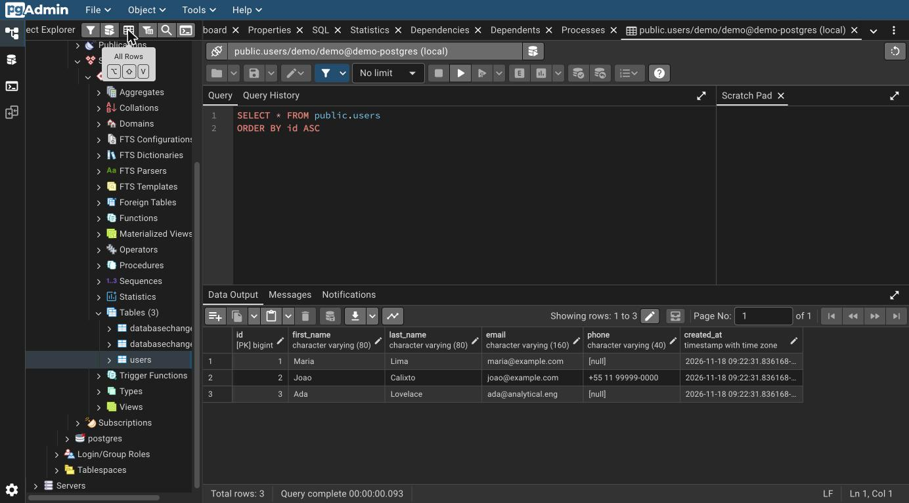

# spring-boot-study-base-project

Projeto base de estudo com Spring Boot 4 e Java 25. Mostra:

- Postgres no Docker + **Liquibase** criando e versionando as tabelas
- Spring Data JPA (com `ddl-auto: validate`)
- Virtual threads (Project Loom)
- JSpecify null-safety
- API Versioning nativo (header)
- HTTP Service Client declarativo
- Spring AI (OpenAI)
- OpenTelemetry

## Pré-requisitos

- **JDK 25** (ex.: `sdk install java 25.0.5.0+8-tem`)
- **Docker** ligado
- Maven não precisa: use o `./mvnw` que já vem no projeto

## Rodar

```bash
# 1. sobe o Postgres (porta 5433 na sua máquina)
docker compose up -d postgres

# 2. sobe a aplicação — o Liquibase cria a tabela users e os dados de exemplo
./mvnw spring-boot:run
```

Para o chat com IA, antes do passo 2: `export OPENAI_API_KEY=sk-...`

## Banco de dados

| | |
|---|---|
| Host / porta | `localhost:5433` |
| Banco | `demo` |
| Usuário / senha | `demo` / `demo123` |
| pgAdmin (opcional) | `docker compose up -d pgadmin` → http://localhost:5050 |

As tabelas **não** são criadas pelo Docker nem pelo Hibernate: quem cria é o Liquibase, a partir de
`src/main/resources/db/changelog/`. Leia [docs/liquibase-boas-praticas.md](docs/liquibase-boas-praticas.md).

Zerar o banco: `docker compose down -v && docker compose up -d postgres`.

### Ver as tabelas

**Pelo pgAdmin (navegador):**

```bash
docker compose up -d pgadmin
```

1. Abra http://localhost:5050 (não pede login).
2. No menu da esquerda: **Aula Spring Boot 4 → demo-postgres (local)**. Ele conecta sozinho, sem pedir senha.
3. Vá em **Databases → demo → Schemas → public → Tables**.
4. Clique em `users` e depois no ícone de tabela no topo (**View Data → All Rows**).



As tabelas `databasechangelog` e `databasechangeloglock` são do próprio Liquibase (controle do que já rodou).

> Mudou `docker/pgadmin/servers.json`? O pgAdmin só lê esse arquivo na primeira vez.
> Para recarregar: `docker compose rm -sf pgadmin && docker volume rm $(basename "$PWD")_pgadmin_data && docker compose up -d pgadmin`.

**Pelo terminal:**

```bash
docker exec -it demo-postgres psql -U demo -d demo -c '\dt' -c 'select * from users'
```

## Endpoints

```bash
# User v1 (padrão)
curl http://localhost:8080/api/users/1

# User v2 (via header)
curl -H "X-API-Version: 2" http://localhost:8080/api/users/1

# HTTP client declarativo (GitHub)
curl http://localhost:8080/api/github/torvalds

# Chat AI
curl -X POST http://localhost:8080/api/chat \
  -H "Content-Type: application/json" \
  -d '{"message":"O que e Spring Boot 4?"}'

# Saúde (inclui o banco) e changesets aplicados pelo Liquibase
curl http://localhost:8080/actuator/health
curl http://localhost:8080/actuator/liquibase
```

### Postman

Importe `postman/spring-boot-study-base-project.postman_collection.json` no Postman
(**Import → arquivo**). Todas as requisições acima estão lá, separadas por pasta, com testes
que conferem o status e o corpo da resposta. Para rodar tudo de uma vez: clique na collection → **Run**.

## Testar

```bash
./mvnw test
```

Os testes sobem um Postgres próprio em container (Testcontainers) e rodam as migrações do zero.
Não precisam do `docker compose`, mas precisam do Docker ligado.

## Observabilidade (opcional)

```bash
docker compose up -d jaeger
# Jaeger UI: http://localhost:16686
```

## Material da aula

- [docs/01-tutorial.md](docs/01-tutorial.md) — tutorial Spring Boot 4
- [docs/02-exercicios.md](docs/02-exercicios.md) — exercícios
- [docs/liquibase-boas-praticas.md](docs/liquibase-boas-praticas.md) — Liquibase: como funciona, boas práticas e comandos
- [docs/tarefa-account.md](docs/tarefa-account.md) — **tarefa: criar a entidade Account**
